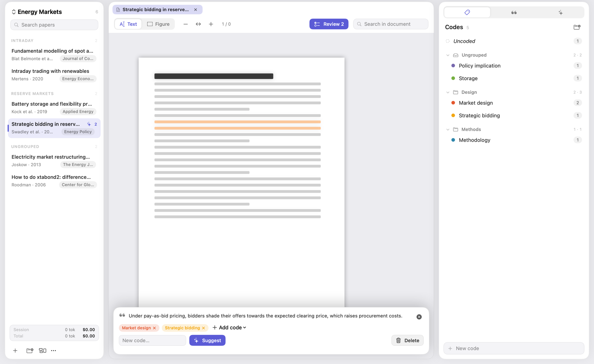
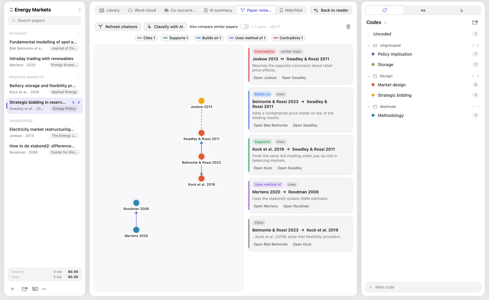
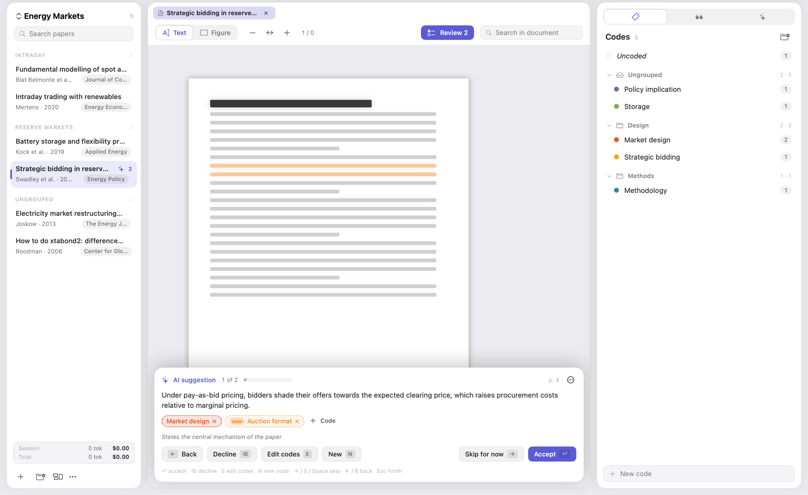
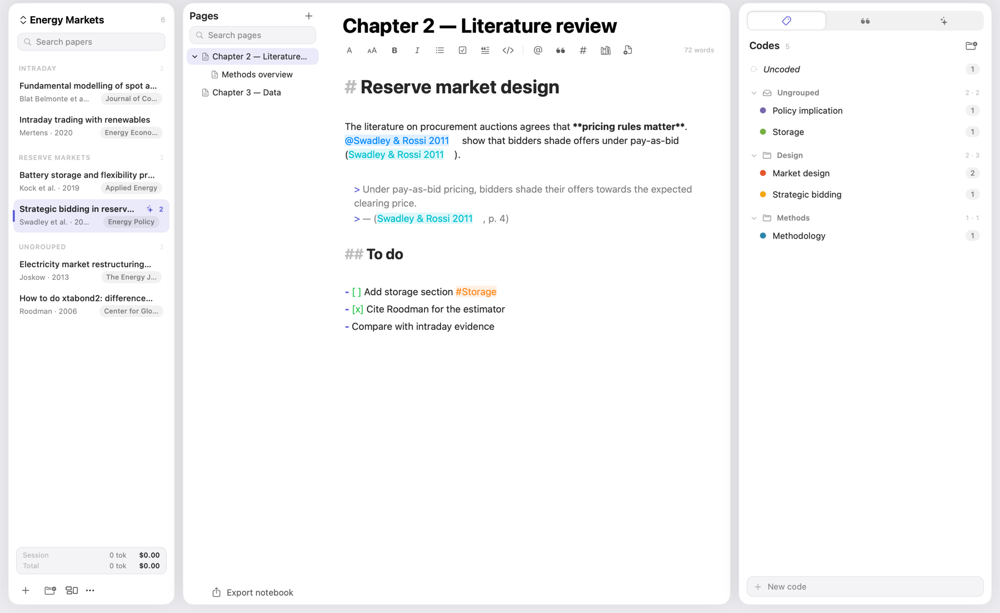

# Scholia

**Read, code and write about your papers — on your Mac.**

Scholia is a research workbench for people who work with many papers: read PDFs, mark and *code* passages and figures, collect what you still want to read, see how your papers relate to each other, and write your chapters in a notebook that cites them. AI helps where you ask it to, with your own Claude account. Everything else stays on your computer.

## Download

**[⬇ Get the latest version](../../releases/latest)** → download `Scholia-<version>.zip`.

Requires **macOS 14 or newer** (Apple Silicon or Intel). The AI features need an Anthropic API key (see below); reading, OCR, coding, the notebook, word clouds and the other charts work without one.

## Install (one time)

1. Unzip the download and drag **Scholia** into your **Applications** folder.
2. Open it. macOS will say it *can't verify the developer* — Scholia is an independent app and is not notarized by Apple. This is expected and only happens once:
   - open **System Settings ▸ Privacy & Security**,
   - scroll to the **Security** section and click **Open Anyway** next to “Scholia”,
   - confirm with your password and open it again.
3. After that Scholia opens like any other app, and **updates install themselves** (see below).

## Your Anthropic API key

AI features (naming, summaries, code suggestions, auto-coding, topics, the paper network, chat) use **your own** Claude API key, so your usage is on your own Anthropic account.

1. Create a key at [console.anthropic.com](https://console.anthropic.com) (**API keys**; you need billing set up there).
2. In Scholia open **Scholia ▸ Settings** (⌘,), paste the key and click **Save to Keychain**.

The key is stored **only in your Mac's Keychain**. It is not in the app, not in your project files, and it is only ever sent to Anthropic. The left bar shows an estimate of the tokens and cost for the current session and in total (click it for details and a CSV export).

**What costs money:** only what you start. Chat and code suggestions use the model chosen in the chat panel. Summaries, naming and tagging, topics, auto-coding and the paper network use a background model (Sonnet 5.5 by default, changeable in Settings). When you add several papers, or use the AI buttons in the Library, you always see a cost estimate before anything is sent.

## What you can do

| | |
|---|---|
| **Read & code** | Big PDF reader with text selection, search and tabs. Select text or draw a box around a figure and apply codes; margin labels show every code next to its passage. Scans are OCR'd on your Mac. |
| **Codes** | Hierarchies, groups, colours, definitions. Double-click a margin label to change a code. Export as REFI-QDA (ATLAS.ti, MAXQDA, NVivo), CSV, JSON or Markdown. |
| **AI auto-coder** | Let Claude propose passages and codes for a paper, then step through them like tracked changes: ↩ accept, ⌫ decline, E edit, → skip. |
| **Notebook** | Pages and subpages with `@` paper tags, `/cite` citations that jump back to the exact sentence, quotes of a code, and a generated reference list. |
| **Library** | Topics, timeline, shared authors, word clouds, code and term co-occurrence, structured AI summaries and a **paper network** (who cites whom; supports, agrees, contradicts). |
| **Watchlist** | Mark a reference in a PDF to collect it; it stays highlighted in the paper and finds links via OpenAlex. |

More screenshots

### Handy shortcuts

Tap **⌘** once (or hold it) to see key tips, then press the letter. The usual ones: **⌘K** apply an existing code · **⌘J** new code · **⌘I** AI code suggestions · **⌘⌥C** auto-code or review · **⌘B** add selection to the watchlist · **⌘⇧N** notebook · **⌘⇧A** analysis · **⌘⇧F** focus mode · **⌘W** close tab.

## Privacy & security

- **No account, no tracking, no analytics.** The developer cannot see your papers, notes, codes or key.
- **Your data stays on your Mac** in `~/Library/Application Support/Scholia/Projects/`. Your original PDFs are copied in and never modified.
- **Network access is limited to three things:** Anthropic (only when you use an AI feature; the text you work with is sent for that request), [OpenAlex](https://openalex.org) (paper *titles* only, to confirm journal and authors — switch it off in Settings), and one small update-list file on GitHub.
- **Updates are verified.** Each update is signed with a key only the developer holds, checked before it is installed, and must carry the same code signature as the app you already have. Damaged or unsigned downloads are refused. Your project files are backed up before an update is installed.
- The app runs with the macOS *hardened runtime*.

## Updates

Scholia checks for a new version when you open it. If there is one, a window lists what changed since your version and offers **Update & restart**. Your projects and your API key are untouched. After the restart a short “What's new” window appears. You can also use **Scholia ▸ Check for Updates…**.

In **Settings ▸ Update channel** you can choose *Stable* (default) or *Beta* (every new version first).

## Where things are stored

| | |
|---|---|
| Projects (notes, codes, quotations, PDFs) | `~/Library/Application Support/Scholia/Projects/` |
| Automatic backups before updates | `~/Library/Application Support/Scholia/Backups/` (**Settings ▸ Show project backups in Finder**) |
| API key | macOS Keychain (item “com.scholia.app.anthropic”) |

To move your projects to another Mac, copy the `Scholia` folder in `Application Support` there.

## Troubleshooting

- **“Scholia can't be opened”** → see *Install*, step 2.
- **macOS asks whether Scholia may use the Keychain** → choose **Always Allow**.
- **AI features say there is no key** → paste it in Settings, or allow the Keychain access above.
- **A scanned PDF can't be selected** → it is OCR'd automatically after import; run **OCR** in the toolbar if it was skipped.
- **An update fails** → the download is not installed and nothing changes; try again or download the latest `.zip` from the Releases page.

## Uninstall

Drag Scholia to the Trash. To remove your data as well, delete `~/Library/Application Support/Scholia` and the Keychain item “com.scholia.app.anthropic” in *Keychain Access*.

---

*Scholia is a personal project and is not affiliated with Anthropic. Cost figures in the app are estimates from list prices and may differ slightly from your invoice. Please don't redistribute the app without asking.*
